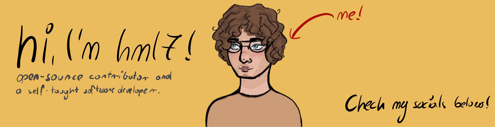

#### projects
*all projects listed below are work in progress*
 - [flag.um](https://github.com/hml7/flag.um) - command-line flag parsing in Umka
 - [uswebka](https://github.com/hml7/uswebka) - static blog generator in Umka

#### socials
 - [linkedin](https://www.linkedin.com/in/mikołaj-laskowski-923609389/)
 - [youtube](https://www.youtube.com/@mynameisherb)
